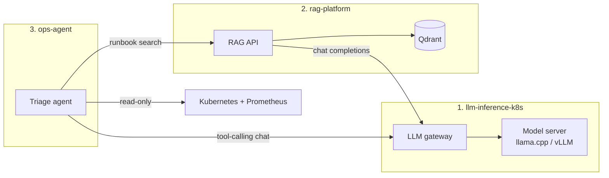

# AI platform showcase

Three small projects that together cover the path from a GPU to an answer:
serving a model on Kubernetes, grounding it in documents, and putting an agent
on top that uses both. Each one runs on its own; together they form one stack.



| Project | What it demonstrates | Runs without |
| --- | --- | --- |
| [`llm-inference-k8s`](projects/llm-inference-k8s) | OpenAI-compatible gateway (auth, rate limiting, load shedding), CPU and GPU model servers, Kustomize overlays, KEDA autoscaling on in-flight requests, SLO alerts, Grafana dashboard, Argo CD, OKE Terraform | a GPU or cloud account |
| [`rag-platform`](projects/rag-platform) | Heading-aware chunking, pluggable embeddings, Qdrant, cited answers, and a retrieval quality gate (recall@k, MRR) enforced in CI | an LLM (for ingest, search, eval) |
| [`ops-agent`](projects/ops-agent) | Tool-calling agent loop with a step budget, validated read-only tools, audit trace, least-privilege RBAC, recorded incident fixtures | a cluster (fixture mode) |

## Quick start

```bash
# Every project: unit tests, no external services needed
for p in projects/llm-inference-k8s/gateway projects/rag-platform projects/ops-agent; do
  (cd "$p" && pip install -q -r requirements.txt -r requirements-dev.txt && python -m pytest -q)
done

# 1. Model serving on a local kind cluster (Docker, kind, kubectl)
make -C projects/llm-inference-k8s up smoke

# 2. RAG service + Qdrant, pointed at the gateway from step 1
(cd projects/rag-platform && docker compose up --build -d && python scripts/ingest_dir.py eval/corpus)

# 3. Agent replaying a recorded incident, with runbook search from step 2
(cd projects/ops-agent && python -m opsagent "Why is the model server failing in namespace llm?" \
    --backend fixture --scenario crashloop-oom --runbook-url http://localhost:8080)
```

Step 3 needs a model that calls tools reliably; see the ops-agent README.

## CI/CD

[`.github/workflows/ci.yml`](.github/workflows/ci.yml) runs on every pull request:

- **test**: ruff and pytest for each project, in a matrix.
- **retrieval quality gate**: fails the build if recall@3 or MRR drops.
- **manifests**: `kustomize build` for every overlay, validated with kubeconform.
- **terraform**: `fmt -check` and `validate`.
- **images**: builds all three images; pushes to GHCR on `main` only.

Delivery is GitOps: Argo CD watches `deploy/overlays/gpu` on `main`
([Application manifest](projects/llm-inference-k8s/deploy/argocd/application.yaml)).


## Verification status

What has and has not been exercised, so nothing here is claimed beyond its evidence:

- **Verified locally**: all unit tests, ruff, the retrieval eval, YAML/JSON parsing of every manifest, and a smoke test of the three services talking over HTTP (gateway, RAG API, agent CLI, load test) with a scripted stand-in for the model.
- **Verified by CI on first push, not before**: Kustomize rendering, Kubernetes schema validation, `terraform validate`, Docker image builds.
- **Not yet run end to end**: the kind deployment, the GPU overlay on a real GPU cluster, and `terraform apply` against OCI.
