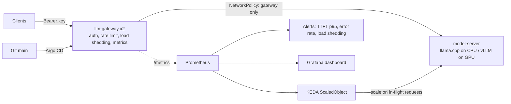

# LLM inference on Kubernetes

A small, complete model-serving stack: an OpenAI-compatible gateway in front of
a model server, deployed with Kustomize, autoscaled on a signal that actually
tracks load, and observable down to time-to-first-token.



## What is here

| Path | What it shows |
| --- | --- |
| `gateway/` | FastAPI gateway: API-key auth, per-tenant token bucket, load shedding, streaming pass-through, Prometheus metrics. Tested with a mocked upstream. |
| `deploy/base` | Hardened gateway Deployment (non-root, read-only root FS, PDB, topology spread) and a NetworkPolicy that isolates the unauthenticated model server. |
| `deploy/model-cpu` | llama.cpp serving a 0.5B quantized model. Runs on a laptop. |
| `deploy/model-gpu` | vLLM on one GPU per replica, with a PVC weight cache and tool calling enabled. |
| `deploy/overlays` | `local` (kind) and `gpu` (KEDA + HPA) environments from the same base. |
| `deploy/observability` | ServiceMonitor, SLO alert rules, Grafana dashboard. |
| `deploy/argocd` | Argo CD Application for GitOps delivery. |
| `terraform/oke` | OKE cluster with a CPU system pool and a GPU pool. |
| `loadtest/` | Load generator reporting TTFT percentiles and tokens/s. |

## Run it locally

Needs Docker, kind, kubectl. No GPU and no cloud account.

```bash
make up          # kind cluster, gateway, CPU model server (downloads ~400 MB of weights)
make smoke       # one chat completion
make loadtest    # TTFT p50/p95 and tokens/s at concurrency 4
make down
```

## Design decisions

**Scale GPU pods on in-flight requests, not utilization.** A GPU serving one
request and one serving a full batch both report close to 100% utilization, so
utilization cannot tell you whether there is headroom. The gateway exports
`gateway_inflight_requests`, and KEDA scales the model server to hold a target
number of in-flight requests per replica. Scale-down is deliberately slow
(10-minute stabilization) because GPU nodes are slow to provision and weights
are slow to load.

**Shed load at the gateway.** Past `GATEWAY_MAX_INFLIGHT`, the gateway returns
429 with `Retry-After` instead of queueing. An unbounded queue in front of a
saturated GPU turns a capacity problem into a latency problem for everyone.

**Readiness follows the model server.** `/readyz` proxies the model server's
health check, so a gateway pod receives no traffic while its backend is still
loading weights.

**Measure what users feel.** Time to first token and completion tokens per
second are first-class metrics, with alert rules on p95 TTFT, 5xx rate, and
sustained load shedding. Streaming usage is captured by asking the model server
to include token usage in the final SSE chunk.

**Tenants are labels, keys are not.** Metrics carry a truncated SHA-256 of the
API key, never the key itself.

## Known limits

- Rate limiting is per gateway replica (in-process). Exact global limits need a
  shared store such as Redis.
- The `local` overlay has no autoscaling; kind has no metrics pipeline by default.
- `vllm/vllm-openai:latest` should be pinned to a digest before real use.
- The Terraform uses one permissive in-VCN security list for readability; split
  it into NSGs for production.

## Measured results

Local kind cluster, llama.cpp with a 0.5B Q4 model and 2 parallel slots, CPU only (Intel(R) Core(TM) Ultra 9 185H).
20 requests per run, 128 max tokens, via `loadtest/loadtest.py`.

| Concurrency | TTFT p50 | TTFT p95 | Total p50 | Throughput |
| --- | --- | --- | --- | --- |
| 2 (matches the 2 model slots) | 0.03s | 0.03s | 1.18s | 142.1 tok/s |
| 4 (2 requests always queued) | 1.24s | 1.60s | 2.49s | 136.6 tok/s |

Doubling concurrency past the slot count added about 1.2s of queueing to every
request and no throughput. The model server was equally busy in both runs, so
utilization would not have shown the problem; in-flight requests did. That is
the signal the GPU overlay autoscales on.

The load test repeats one prompt, so prompt caching makes TTFT at concurrency 2
optimistic. A single uncached request measured about 0.23s of prompt processing.
