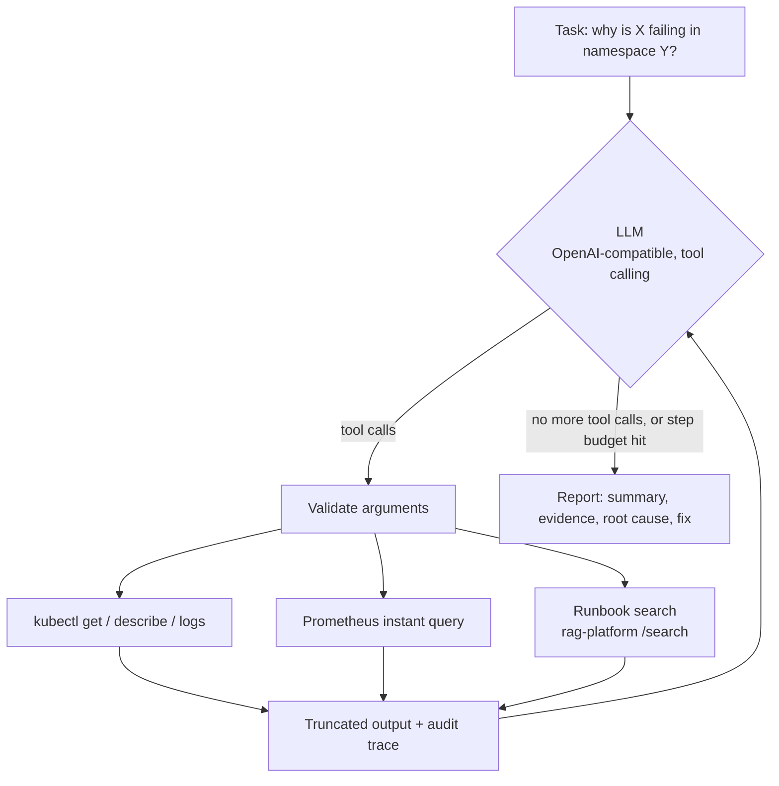

# Ops agent

A tool-calling agent that triages Kubernetes incidents the way an on-call
engineer would: list the pods, look at the unhealthy ones, read the previous
container's logs, check a metric, consult the runbook, then write up what it
found. It is read-only by design and every tool call is recorded.



## What is here

| Path | What it shows |
| --- | --- |
| `opsagent/agent.py` | The loop: bounded steps, tool results fed back, forced final report when the budget runs out. |
| `opsagent/tools.py` | Tool schemas and a validating dispatcher. Bad arguments go back to the model as errors instead of raising. |
| `opsagent/backends.py` | `KubectlBackend` (fixed read-only verbs, argv not shell) and `FixtureBackend` (recorded incidents). |
| `opsagent/fixtures/` | Three incidents: OOMKilled crash loop, GPU pod Pending, ImagePullBackOff. |
| `deploy/rbac.yaml` | Read-only ClusterRole so the API server enforces what the code promises. |
| `tests/` | The loop, guardrails and backends, tested with a scripted model. No LLM or cluster needed. |

## Run it

```bash
pip install -r requirements.txt -r requirements-dev.txt
python -m pytest -q

# Replay a recorded incident. Needs an OpenAI-compatible endpoint with tool calling.
export OPSAGENT_LLM_URL=https://your-endpoint OPSAGENT_MODEL=your-model OPSAGENT_API_KEY=...
python -m opsagent "Why is the model server failing in namespace llm?" \
    --backend fixture --scenario crashloop-oom

# Against your current kubectl context, with runbook search from rag-platform.
python -m opsagent "Pods in namespace rag are not starting" \
    --runbook-url http://localhost:8080 --prometheus-url http://localhost:9090
```

The tool trace prints to stderr and the report to stdout; `--json` emits both.

## Design decisions

**No generic "run a command" tool.** Each tool maps to one fixed read-only
kubectl verb, built as an argv list. The model picks a namespace and a pod
name, both validated against the Kubernetes name grammar. There is no string
the model can produce that turns into `kubectl delete`. RBAC then enforces the
same boundary server-side.

**Errors are observations.** Invalid arguments, unknown tools and malformed
JSON are returned to the model as tool output so it can correct course. The
loop itself does not crash on model mistakes.

**Bounded by construction.** A step budget caps cost and guarantees
termination. When it runs out, the agent is asked for a report from the
evidence so far and to state what it could not verify, and the result is
marked `max_steps` so callers can tell.

**Output is truncated from the front.** Logs and events are newest-last, so
the tail is kept. Context stays small and the relevant lines survive.

**Testable without a model.** The model sits behind a one-method protocol.
Tests script its replies and assert on the tool trace and the messages sent
back, which is where agent bugs actually live.

## Known limits

- Report quality depends on the model. See "Measured behavior" below for what a 3B
  model on CPU gets right and wrong; use the GPU overlay's vLLM deployment or a hosted
  model when the diagnosis has to be dependable.
- Tool output is untrusted text that reaches the model. Read-only tools and
  RBAC limit what an injected instruction in a log line could do, but the
  report itself could still be influenced. Treat it as a draft for a human.
- Tests verify the loop and guardrails, not diagnostic accuracy. An eval that
  scores reports against the known root cause of each fixture is the next step.
- Instant Prometheus queries only; no range queries.

## Measured behavior

Run against the `crashloop-oom` fixture with Qwen2.5-3B-Instruct (Q4) on CPU, served by
the `llm-inference-k8s` local overlay. One run after each change to the tooling, so this
is indicative, not a benchmark:

| Run | Change | Result |
| --- | --- | --- |
| 1 | Baseline | Wrong. Never called `describe_pod`, repeated a log call, sent a pod name as PromQL. Blamed a "configuration issue". |
| 2 | Step-by-step procedure in the prompt, tool descriptions that say what each tool reveals, duplicate-call guard | Right investigation, wrong conclusion. Read the Prometheus timestamp as the memory value and advised lowering the limit. |
| 3 | Prometheus results formatted as one readable line per series | Correct: OOMKilled, exit code 137, 1.99 GiB working set against a 2Gi limit, raise the limit. |

Run 3 still had flaws: it repeated one call (caught by the guard), queried a metric that
does not exist, padded the report with an invented Deployment manifest, and missed the
cheaper fix of lowering `--ctx-size` and `--parallel`. The lesson is that tool output
shaping moved the result more than prompt wording did, and that a 3B model's report is a
draft for a human, not a verdict.
