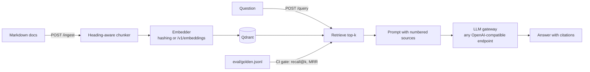

# RAG platform

A retrieval-augmented generation service built the way a platform team would
ship it: a small API, a real vector database, and a retrieval quality gate that
runs in CI so a chunking or embedding change cannot silently make answers worse.



## What is here

| Path | What it shows |
| --- | --- |
| `app/chunking.py` | Splits on Markdown headings first, then packs paragraphs with overlap, so chunks do not straddle topics. |
| `app/embeddings.py` | Pluggable embedders: an offline hashing embedder for CI and an OpenAI-compatible client for real models. |
| `app/store.py` | Qdrant store with deterministic point IDs and replace-on-reingest, so ingestion is idempotent. |
| `app/pipeline.py` | Retrieve, build a cited prompt, generate. |
| `app/main.py` | FastAPI service with `/ingest`, `/search`, `/query`, and Prometheus metrics per pipeline stage. |
| `eval/` | Golden question set over a runbook corpus, with a script that fails CI below a recall@k or MRR threshold. |
| `deploy/` | Qdrant StatefulSet and hardened API Deployment. |

## Run it

```bash
pip install -r requirements.txt -r requirements-dev.txt
python -m pytest -q                 # unit tests, in-process Qdrant, mocked LLM
python -m eval.run_eval --k 3       # retrieval gate: prints recall@k and MRR

docker compose up --build -d        # Qdrant + API on :8080
python scripts/ingest_dir.py eval/corpus
curl -s localhost:8080/search -H 'Content-Type: application/json' \
  -d '{"question": "why is my GPU pod pending?"}'
```

`/query` needs an LLM. Set `RAG_LLM_URL` to any OpenAI-compatible endpoint; the
default expects the `llm-inference-k8s` gateway on `localhost:8000`.

## Design decisions

**Retrieval is tested like code.** `eval/golden.jsonl` maps questions to the
document that should answer them. CI ingests the corpus and fails the build if
recall@3 drops below 0.9 or MRR below 0.8. Most RAG regressions are retrieval
regressions, and they are invisible without a gate like this.

**Ingestion is idempotent.** Point IDs are a UUIDv5 of source and chunk index,
and re-ingesting a document first deletes its old chunks. Running the ingest
job twice, or after a document shrinks, leaves no duplicates or orphans.

**Retrieval is exposed on its own.** `/search` returns hits without an LLM
call. It is cheap, easy to evaluate, and is what the ops agent in this repo
uses as its runbook tool.

**Retrieval drift is a metric.** `rag_top_hit_score` records the similarity of
the best hit per query. A falling distribution means users are asking things
the corpus does not cover, before anyone files a complaint.

## Known limits

- The default hashing embedder is lexical. It keeps tests and CI offline, but
  it will not match paraphrases. Set `RAG_EMBEDDER=openai` and point
  `RAG_EMBEDDING_URL` at an embedding model for semantic retrieval, then
  re-run the eval to compare.
- The golden set is 12 questions over 6 documents. It proves the gate works;
  a production set needs hundreds of cases drawn from real queries.
- No reranker and no hybrid search yet. Both are natural next steps, and the
  eval harness is how you would prove they help.
- The eval measures retrieval only, not answer faithfulness.
